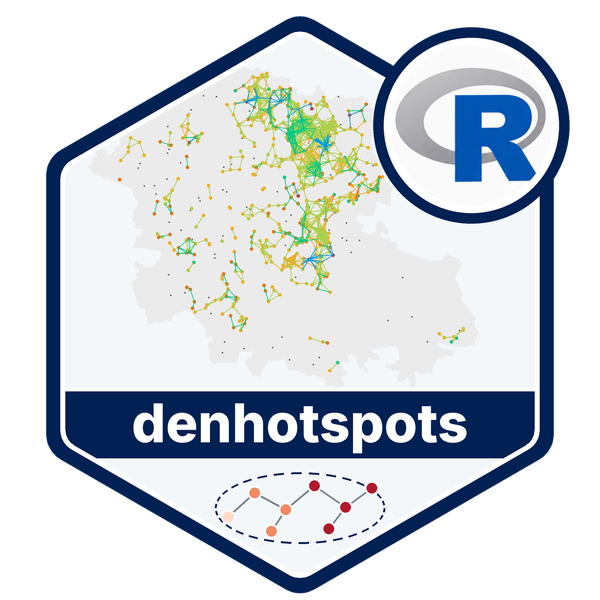

```{r setup, include = FALSE}
lang <- params$lang
tr <- function(en, es) if (identical(lang, "es")) es else en
# ---- datos del paquete ---------------------------------------------------
pkg_info <- list(
    lifecycle = "experimental",
    goal = tr("denhotspots identifies where and when dengue is transmitted inside the cities of Mexico: persistent transmission hotspots, space-time clusters and transmission chains, and the intensity of cases.",
              "denhotspots identifica dónde y cuándo se transmite el dengue dentro de las ciudades de México: hotspots de transmisión persistente, conglomerados espacio-temporales y cadenas de transmisión, e intensidad de casos."),
    overview = tr("It counts geocoded cases by spatial unit (AGEB, H3 hexagons) and calculates the local spatial statistics Getis-Ord Gi* and local spatial heteroscedasticity (Hi) year by year to find persistent hotspots; tests space-time interaction with the Knox test and maps the space-time links and the transmission chains; runs SaTScan space-time scan statistics; and fits spatial log-Gaussian Cox process models with INLA to map the intensity of cases. The hotspots and the intensity are combined with the entomological hotspots of [deneggs](https://fdzul.github.io/deneggs/) into risk maps by AGEB or H3 hexagon.",
                  "Cuenta los casos geocodificados por unidad espacial (AGEB, hexágonos H3) y calcula las estadísticas espaciales locales Getis-Ord Gi* y heterocedasticidad espacial local (Hi) año con año para encontrar hotspots persistentes; prueba la interacción espacio-temporal con la prueba de Knox y mapea los vínculos espacio-temporales y las cadenas de transmisión; corre la estadística de escaneo espacio-temporal de SaTScan; y ajusta modelos de procesos log-Gaussianos de Cox espaciales con INLA para mapear la intensidad de casos. Los hotspots y la intensidad se combinan con los hotspots entomológicos de [deneggs](https://fdzul.github.io/deneggs/) en mapas de riesgo por AGEB o hexágono H3."),
    example = paste(
        "library(denhotspots)",
        "",
        tr("# 1. cases by AGEB and year (cases: geocoded cases with year, long, lat)",
           "# 1. casos por AGEB y año (cases: casos geocodificados con year, long, lat)"),
        "ageb <- rgeomex::extract_ageb(locality = \"Guadalajara\", cve_edo = \"14\")$ageb",
        "x <- point_to_polygons(x = cases, y = ageb, ids = \"CVEGEO\", time = year,",
        "                       coords = c(\"long\", \"lat\"), crs = 4326, dis = \"DENV\")",
        "",
        tr("# 2. hotspots of transmission with Getis-Ord Gi*",
           "# 2. hotspots de transmisión con Getis-Ord Gi*"),
        "hotspots <- gihi(x = x, gi_hi = \"gi\", id = \"CVEGEO\", dis = \"DENV\",",
        "                 time = \"year\", alpha = 0.95)",
        "",
        tr("# 3. space-time interaction with the Knox test (20 days, 400 m)",
           "# 3. interacción espacio-temporal con la prueba de Knox (20 días, 400 m)"),
        "knox_res <- knox_test(x = cases_knox, crs = 4326, dt = 20, ds = 400, sym = 1000,",
        "                      sp_link = FALSE, planar_coord = FALSE)",
        sep = "\n"),
    sources = c(),
    motivation = tr("PAQUETE was born from the need to support evidence-based decisions in the Vector-Borne Diseases (VBD) program of CENAPRECE of the Secretaría de Salud of Mexico: to focus the control of *Aedes aegypti* on the places where dengue is transmitted year after year.",
                    "PAQUETE nace de la necesidad de apoyar la toma de decisiones basada en evidencia en el programa de Enfermedades Transmitidas por Vector (ETV) del CENAPRECE de la Secretaría de Salud de México: enfocar el control de *Aedes aegypti* en los lugares donde el dengue se transmite año con año."),
    disclaimer = FALSE
)
articles <- c()
references <- c(
    "Getis A, Ord JK (1992). The analysis of spatial association by use of distance statistics. *Geographical Analysis*, 24(3), 189-206.",
    "Ord JK, Getis A (2012). Local spatial heteroscedasticity (LOSH). *The Annals of Regional Science*, 48(2), 529-539.",
    "Knox EG (1964). The detection of space-time interactions. *Journal of the Royal Statistical Society C*, 13(1), 25-30.",
    "Kulldorff M (1997). A spatial scan statistic. *Communications in Statistics - Theory and Methods*, 26(6), 1481-1496.",
    "Simpson D, Illian JB, Lindgren F, Sørbye SH, Rue H (2016). Going off grid: computationally efficient inference for log-Gaussian Cox processes. *Biometrika*, 103(1), 49-70."
)
# -------------------------------------------------------------------------

knitr::opts_chunk$set(collapse = TRUE, comment = "#>",
                      fig.path = "man/figures/README-", out.width = "100%")

desc <- read.dcf("DESCRIPTION")
pkg <- unname(desc[, "Package"])
gh <- paste0("fdzul/", pkg)
site <- paste0("https://fdzul.github.io/", pkg)
pkg_info <- lapply(pkg_info, function(x) if (is.character(x)) gsub("PAQUETE", pkg, x) else x)

# Tablas de datasets y funciones exportadas a partir de man/*.Rd
rd_table <- function(kind = c("data", "functions")) {
    kind <- match.arg(kind)
    db <- tools::Rd_db(dir = ".")
    tagged <- function(rd, tag) rd[vapply(rd, function(e) identical(attr(e, "Rd_tag"), tag), logical(1))]
    get <- function(rd, tag) {
        x <- tagged(rd, tag)
        if (length(x)) trimws(gsub("\\s+", " ", paste(unlist(x[[1]]), collapse = ""))) else NA_character_
    }
    info <- do.call(rbind, lapply(db, function(rd) data.frame(
        name = get(rd, "\\name"),
        title = get(rd, "\\title"),
        keyword = paste(vapply(tagged(rd, "\\keyword"), function(e) paste(unlist(e), collapse = ""),
                               character(1)), collapse = " "),
        source = get(rd, "\\source"),
        stringsAsFactors = FALSE)))
    exports <- sub("^export\\((.*)\\)$", "\\1", grep("^export\\(", readLines("NAMESPACE"), value = TRUE))
    exports <- gsub('"', "", exports)
    is_data <- grepl("datasets", info$keyword)
    ref <- paste0(site, "/reference/", info$name, ".html")
    if (kind == "data") {
        x <- info[is_data, ]
        if (!nrow(x)) return(NULL)
        src <- ifelse(is.na(x$source), "", sub("^<?(https?://[^ >]+)>?.*$", "[link](\\1)", x$source))
        out <- data.frame(paste0("[`", x$name, "`](", ref[is_data], ")"), x$title, src)
        names(out) <- c(tr("Dataset", "Base de datos"), tr("Description", "Descripción"), tr("Source", "Fuente"))
    } else {
        keep <- !is_data & info$name %in% exports & !grepl("internal", info$keyword)
        x <- info[keep, ]
        if (!nrow(x)) return(NULL)
        out <- data.frame(paste0("[`", x$name, "()`](", ref[keep], ")"), x$title)
        names(out) <- c(tr("Function", "Función"), tr("Description", "Descripción"))
    }
    out
}
tab_data <- rd_table("data")
tab_fun <- rd_table("functions")
```

<!-- `r tr("README.md is generated from README.Rmd. Please edit that file", "README.es.md se genera desde README.Rmd. Edita ese archivo")` -->

`r tr("**English** · [Español](README.es.md)", "[English](README.md) · **Español**")`

# `r pkg` 

<!-- badges: start -->
[](https://fdzul.r-universe.dev/`r pkg`)
[[[pkg_info$lifecycle]]`.svg)](https://lifecycle.r-lib.org/articles/stages.html)
[](https://github.com/`r gh`/blob/master/LICENSE.md)
<!-- badges: end -->

## `r tr("Overview", "Descripción general")`

`r pkg_info$goal`

`r pkg_info$overview`

`r tr(paste0(pkg, " is part of the [**dengueverse**](https://fdzul.github.io/dengueverse/), a family of R packages for the surveillance, spatial analysis and control of dengue and other *Aedes*-borne diseases in Mexico."), paste0(pkg, " forma parte del [**dengueverse**](https://fdzul.github.io/dengueverse/es/), una familia de paquetes de R para la vigilancia, el análisis espacial y el control del dengue y otras enfermedades transmitidas por *Aedes* en México."))`

```{r datasets-section, echo = FALSE, results = "asis"}
if (!is.null(tab_data)) {
    cat("##", tr("Datasets", "Bases de datos"), "\n\n")
    print(knitr::kable(tab_data, format = "pipe"))
    cat("\n\n", tr("See the full description of each dataset with `?name`.",
                   "Consulta la descripción completa de cada base con `?nombre`."), "\n\n", sep = "")
}
```

```{r functions-section, echo = FALSE, results = "asis"}
if (!is.null(tab_fun)) {
    cat("##", tr("Main functions", "Funciones principales"), "\n\n")
    print(knitr::kable(tab_fun, format = "pipe"))
    cat("\n")
}
```

## `r tr("Installation", "Instalación")`

`r tr("Install the released version from the [dengueverse R-universe](https://fdzul.r-universe.dev):", "Instala la versión publicada desde el [R-universe del dengueverse](https://fdzul.r-universe.dev):")`

```r
install.packages("`r pkg`",
                 repos = c("https://fdzul.r-universe.dev",
                           "https://cloud.r-project.org"))
```

`r tr(paste0("Or the development version from [GitHub](https://github.com/", gh, "):"), paste0("O la versión en desarrollo desde [GitHub](https://github.com/", gh, "):"))`

```r
# install.packages("pak")
pak::pak("`r gh`")
```

## `r tr("Example", "Ejemplo")`

```{r example-code, echo = FALSE, results = "asis"}
cat("```r\n", pkg_info$example, "\n```\n", sep = "")
```

`r tr(paste0("Longer examples are in the [articles](", site, "/articles/) of the website."), paste0("Hay ejemplos más completos en los [artículos](", site, "/articles/) del sitio web."))`

```{r sources-section, echo = FALSE, results = "asis"}
if (length(pkg_info$sources)) {
    cat("##", tr("Data sources", "Fuentes de datos"), "\n\n")
    cat(paste0("- ", pkg_info$sources), sep = "\n")
    if (dir.exists("data-raw")) {
        cat("\n", tr("Processing scripts are in ", "Los scripts de procesamiento están en "),
            "[`data-raw/`](https://github.com/", gh, "/tree/master/data-raw).\n", sep = "")
    }
    cat("\n")
}
```

## `r tr("How to cite", "Cómo citar")`

`r tr(paste0("If you use ", pkg, " in a publication, please cite it:"), paste0("Si usas ", pkg, " en una publicación, por favor cítalo:"))`

```{r citation, echo = FALSE, comment = ""}
if (requireNamespace(pkg, quietly = TRUE)) {
    print(citation(pkg), style = "text")
} else {
    cat("citation(\"", pkg, "\")\n", sep = "")
}
```

```{r articles-section, echo = FALSE, results = "asis"}
if (length(articles)) {
    cat("##", tr(paste("Publications using", pkg), paste("Publicaciones que usan", pkg)), "\n\n")
    cat(paste0("- ", articles), sep = "\n")
    cat("\n")
}
```

```{r references-section, echo = FALSE, results = "asis"}
if (length(references)) {
    cat("##", tr("References", "Referencias"), "\n\n")
    cat(paste0("- ", references), sep = "\n")
    cat("\n")
}
```

## `r tr("Authors and contributors", "Autores y colaboradores")`

```{r authors, echo = FALSE, results = "asis"}
roles <- if (lang == "es") {
    c(aut = "autor", cre = "mantenedor", ctb = "colaborador", dtc = "contribución de datos", fnd = "financiamiento")
} else {
    c(aut = "author", cre = "maintainer", ctb = "contributor", dtc = "data contributor", fnd = "funder")
}
people <- eval(parse(text = desc[, "Authors@R"]))
for (p in people) {
    orcid <- p$comment[["ORCID"]]
    cat("- ", paste(p$given, p$family),
        if (!is.null(orcid)) paste0(" [,
                                    "-A6CE39?logo=orcid&logoColor=white)](https://orcid.org/", orcid, ")"),
        " (", paste(roles[p$role], collapse = ", "), ")\n", sep = "")
}
```

## `r tr("Acknowledgements", "Agradecimientos")`

`r tr("This work was developed at the Instituto Nacional de Salud Pública (INSP), Mexico, in collaboration with the Centro Nacional de Programas Preventivos y Control de Enfermedades (CENAPRECE) of the Secretaría de Salud.", "Este trabajo se desarrolló en el Instituto Nacional de Salud Pública (INSP), México, en colaboración con el Centro Nacional de Programas Preventivos y Control de Enfermedades (CENAPRECE) de la Secretaría de Salud.")`

## `r tr("Motivation", "Motivación")`

`r pkg_info$motivation`

## `r tr("Getting help", "Ayuda")`

- `r tr(paste0("Bugs and feature requests: open an [issue](https://github.com/", gh, "/issues) with a minimal reproducible example ([reprex](https://reprex.tidyverse.org))."), paste0("Errores y sugerencias: abre un [issue](https://github.com/", gh, "/issues) con un ejemplo mínimo reproducible ([reprex](https://reprex.tidyverse.org))."))`
- `r tr("Questions", "Preguntas")`: <felipe.dzul.m@gmail.com>

```{r disclaimer, echo = FALSE, results = "asis"}
if (isTRUE(pkg_info$disclaimer)) {
    cat("##", tr("Disclaimer", "Aviso"), "\n\n")
    cat(tr(paste0("The datasets in ", pkg, " are derived from public sources and are provided for research and public-health purposes. They are not an official product of the original institutions; please check the original sources for official figures."),
           paste0("Las bases de datos de ", pkg, " provienen de fuentes públicas y se ofrecen con fines de investigación y salud pública. No son un producto oficial de las instituciones de origen; consulta las fuentes originales para las cifras oficiales.")), "\n\n")
}
```

## `r tr("License", "Licencia")`

MIT © `r format(Sys.Date(), "%Y")` Felipe Antonio Dzul Manzanilla. `r tr("See", "Ver")` [LICENSE.md](LICENSE.md).

`r tr("Please note that this project is released with a [Contributor Code of Conduct](https://contributor-covenant.org/version/2/1/CODE_OF_CONDUCT.html). By participating in this project you agree to abide by its terms.", "Este proyecto se publica con un [Código de Conducta para colaboradores](https://www.contributor-covenant.org/es/version/2/1/code_of_conduct/). Al participar en este proyecto aceptas cumplir sus términos.")`
