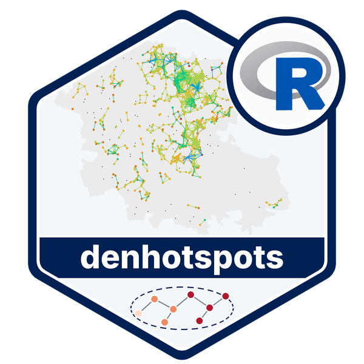

<!-- README.es.md se genera desde README.Rmd. Edita ese archivo -->

[English](README.md) · **Español**

# denhotspots 

<!-- badges: start -->

[](https://fdzul.r-universe.dev/denhotspots)
[](https://lifecycle.r-lib.org/articles/stages.html)
[](https://github.com/fdzul/denhotspots/blob/master/LICENSE.md)
<!-- badges: end -->

## Descripción general

denhotspots identifica dónde y cuándo se transmite el dengue dentro de
las ciudades de México: hotspots de transmisión persistente,
conglomerados espacio-temporales y cadenas de transmisión, e intensidad
de casos.

Cuenta los casos geocodificados por unidad espacial (AGEB, hexágonos H3)
y calcula las estadísticas espaciales locales Getis-Ord Gi\* y
heterocedasticidad espacial local (Hi) año con año para encontrar
hotspots persistentes; prueba la interacción espacio-temporal con la
prueba de Knox y mapea los vínculos espacio-temporales y las cadenas de
transmisión; corre la estadística de escaneo espacio-temporal de
SaTScan; y ajusta modelos de procesos log-Gaussianos de Cox espaciales
con INLA para mapear la intensidad de casos. Los hotspots y la
intensidad se combinan con los hotspots entomológicos de
[deneggs](https://fdzul.github.io/deneggs/) en mapas de riesgo por AGEB
o hexágono H3.

denhotspots forma parte del
[**dengueverse**](https://fdzul.github.io/dengueverse/es/), una familia
de paquetes de R para la vigilancia, el análisis espacial y el control
del dengue y otras enfermedades transmitidas por *Aedes* en México.

## Bases de datos

| Base de datos | Descripción | Fuente |
|:---|:---|:---|
| [`power_laws`](https://fdzul.github.io/denhotspots/reference/power_laws.html) | Theoretical power-law distributions | [link](https://www.tandfonline.com/doi/abs/10.1080/00207390802213609) |
| [`sim_dengue`](https://fdzul.github.io/denhotspots/reference/sim_dengue.html) | Simulated geocoded dengue cases of the metropolitan area of Guadalajara | Simulated with `data-raw/sim_dengue.R`; population of Kontur (popmex::hdx_pop2023) and localities of INEGI 2019 (rgeomex). |

Consulta la descripción completa de cada base con `?nombre`.

## Funciones principales

| Función | Descripción |
|:---|:---|
| [`bivariate_map()`](https://fdzul.github.io/denhotspots/reference/bivariate_map.html) | Bivariate choropleth map of two variables |
| [`cases_by_agem()`](https://fdzul.github.io/denhotspots/reference/cases_by_agem.html) | Count the cases of a vector-borne disease by municipality |
| [`data_geocoden()`](https://fdzul.github.io/denhotspots/reference/data_geocoden.html) | Prepare the addresses of the cases for geocoding |
| [`geocoden()`](https://fdzul.github.io/denhotspots/reference/geocoden.html) | Geocode the addresses of the cases |
| [`gihi()`](https://fdzul.github.io/denhotspots/reference/gihi.html) | Local spatial statistics Getis-Ord Gi\* and Hi by time period |
| [`intensity_plot()`](https://fdzul.github.io/denhotspots/reference/intensity_plot.html) | Map of the intensity of cases |
| [`knox_test()`](https://fdzul.github.io/denhotspots/reference/knox_test.html) | Knox test of space-time interaction |
| [`map_risk()`](https://fdzul.github.io/denhotspots/reference/map_risk.html) | Map of the risk of transmission |
| [`point_to_polygons()`](https://fdzul.github.io/denhotspots/reference/point_to_polygons.html) | Count the geocoded cases by spatial unit and time period |
| [`power_law_plot()`](https://fdzul.github.io/denhotspots/reference/power_law_plot.html) | Plot of the power law of the hotspots |
| [`read_den_dataset()`](https://fdzul.github.io/denhotspots/reference/read_den_dataset.html) | Read the dengue dataset for geocoding |
| [`read_dengue_dataset()`](https://fdzul.github.io/denhotspots/reference/read_dengue_dataset.html) | Read the dengue dataset of SINAVE |
| [`risk_ageb()`](https://fdzul.github.io/denhotspots/reference/risk_ageb.html) | Risk of transmission by AGEB |
| [`risk_h3()`](https://fdzul.github.io/denhotspots/reference/risk_h3.html) | Risk of transmission by H3 hexagon |
| [`satscanR()`](https://fdzul.github.io/denhotspots/reference/satscanR.html) | Run the SaTScan space-time scan statistic |
| [`save_geocoden()`](https://fdzul.github.io/denhotspots/reference/save_geocoden.html) | Save the geocoded dataset |
| [`space_time_link_map()`](https://fdzul.github.io/denhotspots/reference/space_time_link_map.html) | Map of the space-time links of the Knox test |
| [`spatial_lgcp()`](https://fdzul.github.io/denhotspots/reference/spatial_lgcp.html) | Spatial log-Gaussian Cox process model with INLA |
| [`staticmap_intensity()`](https://fdzul.github.io/denhotspots/reference/staticmap_intensity.html) | Static map of the intensity of cases |
| [`staticmap_knoxs()`](https://fdzul.github.io/denhotspots/reference/staticmap_knoxs.html) | Static map of the space-time links of the Knox test |
| [`staticmap_satscan()`](https://fdzul.github.io/denhotspots/reference/staticmap_satscan.html) | Static map of the SaTScan clusters |
| [`subset_den()`](https://fdzul.github.io/denhotspots/reference/subset_den.html) | Subset the dengue dataset by state, municipality and locality |
| [`transmission_chains_map()`](https://fdzul.github.io/denhotspots/reference/transmission_chains_map.html) | Map of the transmission chains |

## Instalación

Instala la versión publicada desde el [R-universe del
dengueverse](https://fdzul.r-universe.dev):

``` r
install.packages("denhotspots",
                 repos = c("https://fdzul.r-universe.dev",
                           "https://cloud.r-project.org"))
```

O la versión en desarrollo desde
[GitHub](https://github.com/fdzul/denhotspots):

``` r
# install.packages("pak")
pak::pak("fdzul/denhotspots")
```

## Ejemplo

``` r
library(denhotspots)

# 1. casos por AGEB y año (cases: casos geocodificados con year, long, lat)
ageb <- rgeomex::extract_ageb(locality = "Guadalajara", cve_edo = "14")$ageb
x <- point_to_polygons(x = cases, y = ageb, ids = "CVEGEO", time = year,
                       coords = c("long", "lat"), crs = 4326, dis = "DENV")

# 2. hotspots de transmisión con Getis-Ord Gi*
hotspots <- gihi(x = x, gi_hi = "gi", id = "CVEGEO", dis = "DENV",
                 time = "year", alpha = 0.95)

# 3. interacción espacio-temporal con la prueba de Knox (20 días, 400 m)
knox_res <- knox_test(x = cases_knox, crs = 4326, dt = 20, ds = 400, sym = 1000,
                      sp_link = FALSE, planar_coord = FALSE)
```

Hay ejemplos más completos en los
[artículos](https://fdzul.github.io/denhotspots/articles/) del sitio
web.

## Cómo citar

Si usas denhotspots en una publicación, por favor cítalo:

    Dzul Manzanilla F, Correa-Morales F, Morales García E, Cruz López C,
    Gómez-Dantés H (2026). _denhotspots: Local Spatial Statistics and
    Space-Time Analysis of Dengue Hotspots_. R package version 0.2.0,
    <https://github.com/fdzul/denhotspots>.

## Referencias

- Getis A, Ord JK (1992). The analysis of spatial association by use of
  distance statistics. *Geographical Analysis*, 24(3), 189-206.
- Ord JK, Getis A (2012). Local spatial heteroscedasticity (LOSH). *The
  Annals of Regional Science*, 48(2), 529-539.
- Knox EG (1964). The detection of space-time interactions. *Journal of
  the Royal Statistical Society C*, 13(1), 25-30.
- Kulldorff M (1997). A spatial scan statistic. *Communications in
  Statistics - Theory and Methods*, 26(6), 1481-1496.
- Simpson D, Illian JB, Lindgren F, Sørbye SH, Rue H (2016). Going off
  grid: computationally efficient inference for log-Gaussian Cox
  processes. *Biometrika*, 103(1), 49-70.

## Autores y colaboradores

- Felipe Antonio Dzul Manzanilla
  [](https://orcid.org/0000-0002-2085-9141)
  (autor, mantenedor)
- Fabián Correa-Morales
  [](https://orcid.org/0000-0002-6193-1242)
  (autor)
- Emmanuel Morales García
  [](https://orcid.org/0000-0002-6837-9227)
  (autor)
- Cecilia Cruz López
  [](https://orcid.org/0000-0002-9156-5669)
  (autor)
- Héctor Gómez-Dantés
  [](https://orcid.org/0000-0002-2025-3641)
  (autor)

## Agradecimientos

Este trabajo se desarrolló en el Instituto Nacional de Salud Pública
(INSP), México, en colaboración con el Centro Nacional de Programas
Preventivos y Control de Enfermedades (CENAPRECE) de la Secretaría de
Salud.

## Motivación

denhotspots nace de la necesidad de apoyar la toma de decisiones basada
en evidencia en el programa de Enfermedades Transmitidas por Vector
(ETV) del CENAPRECE de la Secretaría de Salud de México: enfocar el
control de *Aedes aegypti* en los lugares donde el dengue se transmite
año con año.

## Ayuda

- Errores y sugerencias: abre un
  [issue](https://github.com/fdzul/denhotspots/issues) con un ejemplo
  mínimo reproducible ([reprex](https://reprex.tidyverse.org)).
- Preguntas: <felipe.dzul.m@gmail.com>

## Licencia

MIT © 2026 Felipe Antonio Dzul Manzanilla. Ver [LICENSE.md](LICENSE.md).

Este proyecto se publica con un [Código de Conducta para
colaboradores](https://www.contributor-covenant.org/es/version/2/1/code_of_conduct/).
Al participar en este proyecto aceptas cumplir sus términos.
