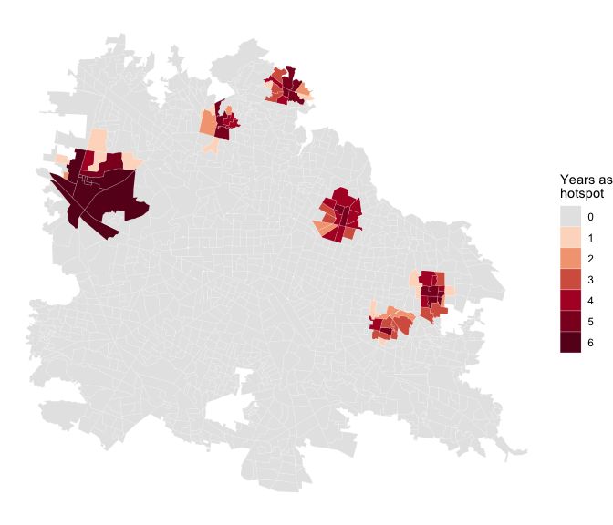
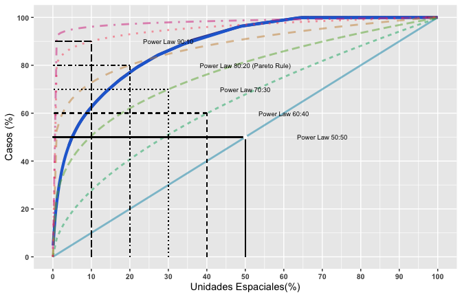

A **transmission hotspot** is a spatial unit (here, an AGEB) with many more
cases than expected, surrounded by units that also have many cases. When the
same units are hotspots year after year, they are **persistent hotspots**: the
places where dengue is transmitted every season and where vector control
gives the largest return. This article finds them with the local statistic
Getis-Ord Gi* (Getis & Ord 1992; Ord & Getis 1995), calculated year by year.

The example uses `sim_dengue`, **simulated** geocoded cases of the
metropolitan area of Guadalajara (2019-2024); with the real geocoded dataset
the steps are the same.


``` r
library(denhotspots)
library(ggplot2)
```

## 1. The cases


``` r
table(sim_dengue$ANO)
#> 
#> 2019 2020 2021 2022 2023 2024 
#> 1413  414  259  597 1139 1680
```

## 2. The AGEB of the metropolitan area

The urban AGEB of Guadalajara, Zapopan, Tlaquepaque and Tonalá come from
[rgeomex](https://fdzul.github.io/rgeomex/):


``` r
ageb <- rgeomex::extract_ageb(locality = c("Guadalajara", "Zapopan", "Tlaquepaque", "Tonalá"),
                              cve_edo = "14")$ageb
ageb <- ageb[, "CVEGEO"]
nrow(ageb)
#> [1] 1270
```

## 3. Cases by AGEB and year

`point_to_polygons()` counts the cases of each AGEB in each year; the result
has one column per year (`DENV_2019`, ..., `DENV_2024`).


``` r
x <- point_to_polygons(x = sim_dengue, y = ageb, ids = "CVEGEO", time = ANO,
                       coords = c("long", "lat"), crs = 4326, dis = "DENV")
head(sf::st_drop_geometry(x))
#>          CVEGEO DENV_2019 DENV_2020 DENV_2021 DENV_2022 DENV_2023 DENV_2024
#> 1 1403900013482         1         0         0         0         1         0
#> 2 1403900012696         0         0         0         0         0         0
#> 3 1403900014207         0         0         0         0         2         0
#> 4 1403900013020         2         0         0         0         0         0
#> 5 1403900014194         0         0         1         0         1         0
#> 6 1403900015243         0         0         0         0         0         1
```

## 4. Hotspots with Getis-Ord Gi*

`gihi()` calculates Gi* for each year with a queen-contiguity neighbourhood
that includes the AGEB itself, and marks as hotspot the AGEB whose Gi* is
above the Bonferroni-corrected critical value (`alpha = 0.95`). It returns,
for each AGEB, the number of years it was a hotspot (`intensity_gi`) and
whether it was a hotspot at least once (`hotspots_gi`).


``` r
hotspots <- gihi(x = x, gi_hi = "gi", id = "CVEGEO", dis = "DENV",
                 time = "year", alpha = 0.95)
table(hotspots$intensity_gi)
#> 
#>    0    1    2    3    4    5    6 
#> 1185   14    9   16   19   16   11
```


``` r
ggplot(hotspots) +
    geom_sf(aes(fill = factor(intensity_gi)), colour = "white", linewidth = 0.05) +
    scale_fill_manual(values = c("0" = "grey90", "1" = "#FDDBC7", "2" = "#F4A582",
                                 "3" = "#D6604D", "4" = "#B2182B", "5" = "#8C0D25",
                                 "6" = "#67001F"),
                      name = "Years as\nhotspot") +
    theme_void()
```

<div class="figure">

<p class="caption">Number of years (2019-2024) that each AGEB was a hotspot.</p>
</div>

The AGEB that were hotspots in most years are the persistent hotspots.

## 5. How many cases are in the hotspots?

A few AGEB concentrate a large share of the cases. Sorting the AGEB from more
to fewer cases and accumulating, the curve shows the percentage of the cases
(y) in a percentage of the AGEB (x); the dashed lines are theoretical power
laws (`power_laws`).


``` r
cases <- rowSums(sf::st_drop_geometry(x)[, grep("^DENV_", names(x))], na.rm = TRUE)
d <- data.frame(n = cases, hotspots_gi = hotspots$hotspots_gi, loc = "Guadalajara")
d <- d[order(-d$n), ]
d$id_perc_cum <- seq_len(nrow(d)) / nrow(d) * 100
d$perc_cumsum_n <- cumsum(d$n) / sum(d$n) * 100

# share of the cases in the hotspots, and share of the AGEB they are
round(100 * c(cases = sum(d$n[d$hotspots_gi == 1]) / sum(d$n),
              ageb = mean(d$hotspots_gi == 1)), 1)
#> cases  ageb 
#>  52.0   6.7
```


``` r
power_law_plot(d)
```

<div class="figure">

<p class="caption">Cumulative percentage of cases by percentage of AGEB.</p>
</div>

## References

- Getis A, Ord JK (1992). The analysis of spatial association by use of
  distance statistics. *Geographical Analysis*, 24(3), 189-206.
- Ord JK, Getis A (1995). Local spatial autocorrelation statistics:
  distributional issues and an application. *Geographical Analysis*, 27(4),
  286-306.
