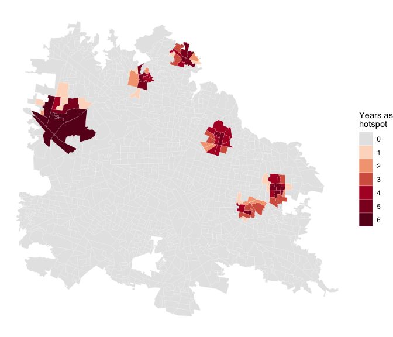
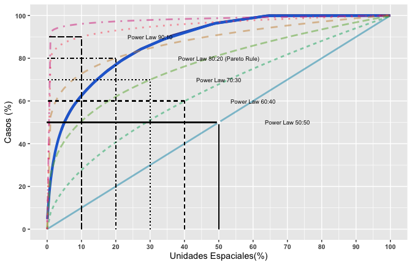

Un **hotspot de transmisión** es una unidad espacial (aquí, un AGEB) con
muchos más casos de los esperados, rodeada de unidades que también tienen
muchos casos. Cuando las mismas unidades son hotspots año tras año, son
**hotspots persistentes**: los lugares donde el dengue se transmite cada
temporada y donde el control vectorial rinde más. Este artículo los encuentra
con la estadística local Getis-Ord Gi* (Getis y Ord 1992; Ord y Getis 1995),
calculada año con año.

El ejemplo usa `sim_dengue`, casos geocodificados **simulados** de la zona
metropolitana de Guadalajara (2019-2024); con la base geocodificada real los
pasos son los mismos.


``` r
library(denhotspots)
library(ggplot2)
```

## 1. Los casos


``` r
table(sim_dengue$ANO)
#> 
#> 2019 2020 2021 2022 2023 2024 
#> 1413  414  259  597 1139 1680
```

## 2. Los AGEB de la zona metropolitana

Los AGEB urbanos de Guadalajara, Zapopan, Tlaquepaque y Tonalá vienen de
[rgeomex](https://fdzul.github.io/rgeomex/):


``` r
ageb <- rgeomex::extract_ageb(locality = c("Guadalajara", "Zapopan", "Tlaquepaque", "Tonalá"),
                              cve_edo = "14")$ageb
ageb <- ageb[, "CVEGEO"]
nrow(ageb)
#> [1] 1270
```

## 3. Casos por AGEB y año

`point_to_polygons()` cuenta los casos de cada AGEB en cada año; el resultado
tiene una columna por año (`DENV_2019`, ..., `DENV_2024`).


``` r
x <- point_to_polygons(x = sim_dengue, y = ageb, ids = "CVEGEO", time = ANO,
                       coords = c("long", "lat"), crs = 4326, dis = "DENV")
head(sf::st_drop_geometry(x))
#>          CVEGEO DENV_2019 DENV_2020 DENV_2021 DENV_2022 DENV_2023 DENV_2024
#> 1 1403900013482         1         0         0         0         1         0
#> 2 1403900012696         0         0         0         0         0         0
#> 3 1403900014207         0         0         0         0         2         0
#> 4 1403900013020         2         0         0         0         0         0
#> 5 1403900014194         0         0         1         0         1         0
#> 6 1403900015243         0         0         0         0         0         1
```

## 4. Hotspots con Getis-Ord Gi*

`gihi()` calcula Gi* para cada año con una vecindad de contigüidad tipo reina
que incluye al propio AGEB, y marca como hotspot al AGEB cuyo Gi* supera el
valor crítico con corrección de Bonferroni (`alpha = 0.95`). Devuelve, para
cada AGEB, el número de años que fue hotspot (`intensity_gi`) y si fue hotspot
al menos una vez (`hotspots_gi`).


``` r
hotspots <- gihi(x = x, gi_hi = "gi", id = "CVEGEO", dis = "DENV",
                 time = "year", alpha = 0.95)
table(hotspots$intensity_gi)
#> 
#>    0    1    2    3    4    5    6 
#> 1185   14    9   16   19   16   11
```


``` r
ggplot(hotspots) +
    geom_sf(aes(fill = factor(intensity_gi)), colour = "white", linewidth = 0.05) +
    scale_fill_manual(values = c("0" = "grey90", "1" = "#FDDBC7", "2" = "#F4A582",
                                 "3" = "#D6604D", "4" = "#B2182B", "5" = "#8C0D25",
                                 "6" = "#67001F"),
                      name = "Years as\nhotspot") +
    theme_void()
```

<div class="figure">

<p class="caption">Número de años (2019-2024) que cada AGEB fue hotspot.</p>
</div>

Los AGEB que fueron hotspots en la mayoría de los años son los hotspots persistentes.

## 5. ¿Cuántos casos hay en los hotspots?

Pocos AGEB concentran una gran parte de los casos. Al ordenar los AGEB de más
a menos casos y acumular, la curva muestra el porcentaje de los casos (y) en
un porcentaje de los AGEB (x); las líneas punteadas son leyes de potencia
teóricas (`power_laws`).


``` r
cases <- rowSums(sf::st_drop_geometry(x)[, grep("^DENV_", names(x))], na.rm = TRUE)
d <- data.frame(n = cases, hotspots_gi = hotspots$hotspots_gi, loc = "Guadalajara")
d <- d[order(-d$n), ]
d$id_perc_cum <- seq_len(nrow(d)) / nrow(d) * 100
d$perc_cumsum_n <- cumsum(d$n) / sum(d$n) * 100

# porcentaje de los casos en los hotspots y porcentaje de los AGEB que son
round(100 * c(cases = sum(d$n[d$hotspots_gi == 1]) / sum(d$n),
              ageb = mean(d$hotspots_gi == 1)), 1)
#> cases  ageb 
#>  52.0   6.7
```


``` r
power_law_plot(d)
```

<div class="figure">

<p class="caption">Porcentaje acumulado de casos por porcentaje de AGEB.</p>
</div>

En la zona simulada, los hotspots son el 6.7% de los AGEB pero concentran el
52% de los casos.

## Referencias

- Getis A, Ord JK (1992). The analysis of spatial association by use of
  distance statistics. *Geographical Analysis*, 24(3), 189-206.
- Ord JK, Getis A (1995). Local spatial autocorrelation statistics:
  distributional issues and an application. *Geographical Analysis*, 27(4),
  286-306.
