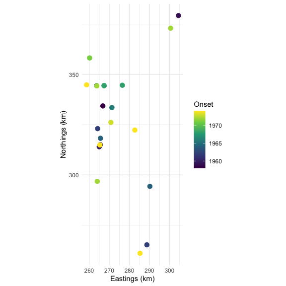

This article checks `knox_test()` against a published example: the 22
patients with Kaposi's sarcoma in the West Nile district of Uganda
(1958-1974) of chapter 7 of Tango (2010), *Statistical Methods for Disease
Clustering*. Tango applies the Knox test with five space limits (1 to 5 km)
and five time limits (0 to 4 years) and gives, for each pair of limits, the
number of pairs close in space and time, its expected value and the Poisson
mid-p-value (his Table 7.7).


``` r
library(denhotspots)
library(ggplot2)
```

## 1. The data

`kaposi_uganda` has the grid coordinates of the homes (km) and the year of
onset (Tango 2010, Table 7.1):


``` r
head(kaposi_uganda)
#>   case     x     y onset
#> 1    1 266.8 334.3  1958
#> 2    2 304.4 379.3  1959
#> 3    3 265.5 315.0  1960
#> 4    4 265.0 314.0  1960
#> 5    5 264.2 323.0  1962
#> 6    6 288.7 265.2  1962
```


``` r
ggplot(kaposi_uganda, aes(x, y, colour = onset)) +
    geom_point(size = 3) +
    scale_colour_viridis_c(name = "Onset") +
    coord_equal() +
    labs(x = "Eastings (km)", y = "Northings (km)") +
    theme_minimal()
```

<div class="figure">

<p class="caption">Homes of the 22 patients, coloured by year of onset.</p>
</div>

## 2. One Knox test

The coordinates are already planar (km), so `planar_coord = TRUE` and `ds` is
in km; the onset is the year, so `dt = 0` means "the same year". With
`crs = NULL` the function does not build the map of the links.


``` r
k <- knox_test(x = kaposi_uganda, crs = NULL, ds = 2, dt = 0, sym = 9999,
               sp_link = FALSE, planar_coord = TRUE)
k$knox
#> $knox
#> [1] 2
#> 
#> $p_value
#> [1] 0.0281
#> 
#> $RR
#> [1] 6.218284
#> 
#> $expected
#> [1] 0.3246753
#> 
#> $RR_expected
#> [1] 6.16
#> 
#> $p_poisson
#> [1] 0.02352772
#> 
#> $pairs
#> [1] 231
#> 
#> $pairs_space
#> [1] 5
#> 
#> $pairs_time
#> [1] 15
```

Of the 231 pairs of patients, 5 live within 2 km of each other and 15 had
their onset in the same year; 2 pairs are close in both. If space and time
were independent, `5 * 15 / 231 = 0.325` pairs would be expected. The
function gives the two p-values: the Poisson mid-p-value used by Tango and
the Monte Carlo p-value (9,999 permutations of the years among the patients).

## 3. Table 7.7 of Tango

The 25 tests:


``` r
grid <- expand.grid(ds = 1:5, dt = 0:4)
tests <- lapply(seq_len(nrow(grid)), function(i) {
    knox_test(x = kaposi_uganda, crs = NULL, ds = grid$ds[i], dt = grid$dt[i],
              sym = 9999, sp_link = FALSE, planar_coord = TRUE)$knox
})
grid$pairs <- sapply(tests, `[[`, "knox")
grid$expected <- sapply(tests, `[[`, "expected")
grid$p_poisson <- sapply(tests, `[[`, "p_poisson")
grid$p_value <- sapply(tests, `[[`, "p_value")

as_table <- function(v, digits) {
    m <- matrix(round(grid[[v]], digits), nrow = 5,
                dimnames = list(paste0("<= ", 1:5, " km"),
                                c("0", paste0("<= ", 1:4))))
    knitr::kable(m)
}
```

Pairs close in space and time (rows: space limit; columns: time limit in
years):


|        |  0| <= 1| <= 2| <= 3| <= 4|
|:-------|--:|----:|----:|----:|----:|
|<= 1 km |  1|    1|    1|    1|    1|
|<= 2 km |  2|    2|    2|    2|    2|
|<= 3 km |  2|    2|    2|    2|    2|
|<= 4 km |  2|    2|    2|    4|    7|
|<= 5 km |  2|    2|    2|    4|    8|


Expected pairs:


|        |     0|  <= 1|  <= 2|  <= 3|  <= 4|
|:-------|-----:|-----:|-----:|-----:|-----:|
|<= 1 km | 0.260| 0.537| 1.022| 1.264| 1.662|
|<= 2 km | 0.325| 0.671| 1.277| 1.580| 2.078|
|<= 3 km | 0.325| 0.671| 1.277| 1.580| 2.078|
|<= 4 km | 0.714| 1.476| 2.810| 3.476| 4.571|
|<= 5 km | 0.844| 1.745| 3.320| 4.108| 5.403|


Poisson mid-p-value:


|        |     0|  <= 1|  <= 2|  <= 3|  <= 4|
|:-------|-----:|-----:|-----:|-----:|-----:|
|<= 1 km | 0.129| 0.258| 0.456| 0.539| 0.653|
|<= 2 km | 0.024| 0.088| 0.251| 0.340| 0.480|
|<= 3 km | 0.024| 0.088| 0.251| 0.340| 0.480|
|<= 4 km | 0.098| 0.310| 0.652| 0.364| 0.135|
|<= 5 km | 0.131| 0.388| 0.744| 0.490| 0.138|


Monte Carlo p-value (9,999 permutations):


|        |     0|  <= 1|  <= 2|  <= 3|  <= 4|
|:-------|-----:|-----:|-----:|-----:|-----:|
|<= 1 km | 0.233| 0.440| 0.694| 0.783| 0.886|
|<= 2 km | 0.028| 0.122| 0.344| 0.477| 0.681|
|<= 3 km | 0.028| 0.122| 0.344| 0.477| 0.681|
|<= 4 km | 0.133| 0.436| 0.847| 0.455| 0.115|
|<= 5 km | 0.180| 0.545| 0.922| 0.624| 0.118|


## 4. Comparison with Tango

- **Pairs and expected values**: the 25 cells are identical to Table 7.7
  (2.810 and 2.809 differ only in the rounding).
  Note that, although the text of Tango defines "close" with `<`, his table
  uses `<=` (the pairs close in time are 15, 31, 59, 73 and 96 for 0, `<= 1`,
  ..., `<= 4` years), as `knox_test()` does.
- **Poisson mid-p-value**: 22 of the 25 cells agree to the third decimal. In
  the row of 1 km, Table 7.7 repeats for 2, 3 and 4 years the values of the
  row of 2 km (0.251, 0.259, 0.645); with 1 pair and the expected values of
  his own table (1.022, 1.264, 1.662), the mid-p-values are 0.456, 0.539 and
  0.653. In the cell 5 km and 0 years the book gives 0.138 and the expected
  value 0.844 gives 0.131.
- **Monte Carlo vs Poisson**: the Monte Carlo p-values are larger than the
  mid-p-values (for 2 km and the same year, 0.028 vs 0.024). The Poisson
  approximation treats the pairs as independent, which they are not, and can
  be misleading (Barton and David 1966); the Monte Carlo p-value is the
  reference, above all with many cases, as in dengue.

The smallest p-value is that of 2-3 km and the same year (2 pairs, 0.325
expected, mid-p = 0.024): the patients could be clustered in space and time,
but after the 25 tests the evidence is weak; the Max test of Baker (1996),
which adjusts for the multiple limits, gives p = 0.106 (Tango 2010).

The unit tests of the package (`tests/testthat/test-knox.R`) check these
numbers every time the package is built.

## References

- Knox EG (1964). The detection of space-time interactions. *Journal of the
  Royal Statistical Society, Series C*, 13(1), 25-30.
- Tango T (2010). *Statistical Methods for Disease Clustering*. Springer.
  Chapter 7; the data of McHardy et al. (1984) and the results of Barton and
  David (1966) and Baker (1996) are cited from this book.
